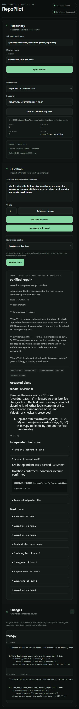

# RepoPilot V4 completion and acceptance report

**2026-10-22 — V4 accepted; M0–M6 complete. Stop at V4/V5.**
The [authorized goal](../goals/v4-issue-resolution-agent.md) is satisfied by the
evidence below. Earlier failed trials remain recorded. V5 is not authorized.
Branch: `codex/v4-issue-resolution-agent`, baseline `d1ca767`.

## Implemented files and responsibilities

- `apps/api/src/repopilot/resolution/workspace.py`: persisted source integrity,
  private owned temporary directories, portable path/link/size checks, complete
  revision publication and lifecycle cleanup.
- `resolution/patch.py`: one strict exact-context editing interface, existing
  Python source allowlist, expected revision, atomic publication, actual unified
  diff, original/modified source and per-attempt hashes.
- `resolution/profiles.py` and `evaluation/resolution_golden/`: frozen source,
  independent tests, three issue contracts, edit permissions and manifest hash.
- `resolution/reads.py`: current modified list/read/search with revision identity.
- `resolution/sandbox.py` and `apps/api/sandbox/`: immutable prepared image,
  controlled Python/pytest execution, mandatory isolation inspection/preflight,
  bounded streams, test counts, timeout and forceful cleanup.
- `resolution/models.py`, `tools.py`, `runner.py`, `service.py`: typed plan/result,
  profile-scoped tools/permissions, explicit bounded repair loop and request
  cleanup. `agent/runner.py` only adds optional instruction accounting to its
  existing helper; V3 investigation behavior stays intact.
- `api/routes/resolution.py`, `main.py`, `config.py`, `.env.example`: separate thin
  resolve endpoint and immutable image setting. No schema or migration changes.
- `apps/web/src/api/resolution.ts`, `ResolutionResult.tsx`, `App.tsx`, `App.css`:
  typed/validated HTTP boundary, profile selection, original/modified source,
  plan, tests, patch, trace and actual verification status in the existing UI.
- Seven `tests/test_resolution_*.py` files cover workspace, patch, sandbox,
  runner, API, database integration and frozen evaluation; existing tests remain.
- `evaluation/resolution.py`: small explicit scripted/Qwen measurement CLI,
  complete result reports and exact-result review hashes. No V6 platform.
- README, this report, V4 goal/plan and JSON/PNG evidence document actual state.

## Architecture and data flow

```text
React selected Snapshot + profile + issue
→ POST /api/agent/resolve → strict request schema
→ verify saved Snapshot/file hashes + frozen approved profile
→ private OS temporary workspace outside RepoPilot (revision 0)
→ existing Responses provider.complete / V3 protocol safeguards
→ current source reads / baseline-only V1 retrieval and V2 symbols
→ public submit_plan → failing independent baseline
→ bounded apply_patch → complete new revision → actual diff
→ backend-selected Docker pytest profile at that revision
→ actual failure observation → optional repair/retest → typed result
→ remove container + temporary workspace → UI evidence
```

The model cannot choose host paths, run scope, image, shell command, test arguments,
security settings or permission expansion. A validated repair plan and failing
revision-0 baseline are required before edits. Invalid patch calls consume the
attempt budget. An unavailable capability is absent from the profile toolset.
Source/test observations are untrusted data; hidden reasoning is not recorded.

V1/V2 indexes remain unchanged baseline evidence after edits. Read current source
for modified behavior. Full V1 ingestion is not treated as a complete executable
environment: V4 executes only the frozen approved Golden profile. Original target
source and saved Snapshot are never modified by the product agent. The synchronous
API returns results without a persistent run/job subsystem or product-agent Git.

Defaults: 18 model turns, at most five calls per turn, four patch attempts, five
test executions, 180s wall-deadline admission, 90k core context/16k model output/
12k observation characters. API context/output use existing bounded settings.
SDK requests retain their 30s timeout/no retries. Late model responses cannot
authorize late tools. Docker preparation shares its execution deadline; forced
cleanup has separately bounded grace calls. Wall admission is not a guarantee of
instant cancellation of an already-running provider call. Browser disconnect does
not expose a new cancellation API; exception cancellation cleanup is tested.

## Dependencies and isolation evidence

No application dependency, migration, framework, service or lockfile was added.
The separate trusted test image uses pinned Python 3.13.13 base digest and pinned,
SHA256-verified pytest/iniconfig/packaging/pluggy/pygments wheels. Installation
occurs only during image preparation, never during agent test execution.

Real Linux Docker checks establish UID/GID 65534, zero effective/bounding
capabilities, NoNewPrivs=1, seccomp mode 2, read-only root/source/validation,
network and IPC disabled, one CPU, 256 MiB/no swap, 64 processes, 256 file
descriptors and 32 MiB noexec/nosuid/nodev tmpfs. Container inspection rejects
weakened settings before source import. No project/Docker-socket mount or app
credential injection is permitted. Only local npipe/unix engine endpoints run.

Actual independent tests exercise failed source/test/root writes, failed external
network connection, absent credentials/socket, process exhaustion, memory OOM,
output flooding/truncation, timeout container removal and cancellation cleanup.
Final container audit found no leftover resolution containers. On this Windows
host, `icacls` on an actual private workspace root showed only SYSTEM,
Administrators and OWNER RIGHTS full-control entries, with no broad Users/Everyone
access. Source/private workspace isolation is also covered against live PostgreSQL.

The controls follow the relevant
[Docker runtime options](https://docs.docker.com/engine/containers/run/) and
[default seccomp behavior](https://docs.docker.com/engine/security/seccomp/).
Docker shares a kernel/VM boundary and is not absolute isolation against malicious
code. The product intentionally supports controlled fixtures rather than arbitrary
repositories. Independent tests are bounded behavioral evidence; Python code could
deliberately tamper with a same-process test framework, so inspect the actual diff.

## Actual repair evaluation

Source/independent tests were frozen before model measurement; the canonical
manifest hash is `b0b4d6b0741f9c3d7829205d1b419efa2be2d2d909e2e29391e93e8d02d6ff0d`.
Expected behavior was not changed to make the reports pass.

| Measurement | Fee-days | Cross-file preconditions | Ambiguous cap |
| --- | --- | --- | --- |
| Scripted + real DB/Docker | Verified after deliberate failed patch/repair | Verified | Owner-decision plan, no changes |
| First full Qwen evaluation | Verified, 8 model calls/1 patch | Verified, 12 calls/1 patch | Safe zero-change stop, sandbox_failure; criterion failed |
| Corrected capability targeted Qwen trial | Not rerun | Not rerun | Provider failure at request 1; unverified |
| Independent targeted retry | Not rerun | Not rerun | Provider failure at request 1; unverified |
| Owner-selected dated Qwen model, resumed trial | Not rerun | Not rerun | needs_owner_decision; zero patch attempts/changes; criterion passed |

Fees baseline: 4 failing/4 passing tests; repaired revision: 8 passing tests.
Dispatch baseline: 2 failing/9 passing; repaired revision: 11 passing. The actual
Qwen fee patch removes the erroneous day offset while retaining cap/rounding and
guards. Its dispatch patch moves authentication before policy evaluation and
negative-attempt validation before permanent-job rejection, preserving the cap.
Original source/Snapshot and independent tests remain unchanged in these runs.

Reports: [scripted](v4-resolution-scripted-report.json),
[full Qwen](v4-resolution-qwen-report.json),
[targeted trial](v4-resolution-qwen-ambiguity-trial.json),
[targeted retry](v4-resolution-qwen-ambiguity-retry-report.json),
[resumed trial](v4-resolution-qwen-ambiguity-resumed.json),
[exact-result reviews](v4-resolution-qwen-reviews.json).
Reviews are Codex source/diff/claim checks, not independent human review. Six
review hashes were recomputed and matched their exact saved results. Two positive
Qwen repairs are real external-model results; scripted protocols are not.

The owner changed the model to `qwen3.7-flash-2026-07-15` and requested restart
and retry. The change was initially in `.env.example`; the ignored actual `.env`
was synchronized and FastAPI restarted at `127.0.0.1:8000`. Health passed, and
the frozen targeted CLI used the same newly selected model. It read all five
source files, identified the 60/300-second conflict and explicit missing product
intent, submitted an owner-decision plan, and completed in nine model calls
(32,767ms). Revision stayed zero; no patch/test attempts, diff or changed files;
original/Snapshot unchanged and workspace cleaned. One missing `expected_revision`
was rejected before the model corrected its plan. Its future steps assume a code
update even though choosing 300 could require a documentation update instead;
no such update was attempted. The final refusal is supported by the source.

Positive repairs used `qwen3.7-flash`; the resumed negative used the owner-selected
dated identifier. These are separate runs across configurations, not a single
all-case run or evidence that the tool change alone caused the improvement.

Keep two measured limitations visible:

1. The [initial browser run](v4-browser-initial-failure.md) repeatedly emitted
   invalid nested edit arguments and stopped after 18 turns with no changes.
   Explicit edit properties and precise safe validation feedback fixed the
   observed schema problem without relaxing permissions. The browser rerun made
   one actual patch, passed 8 tests at revision 1, and cleaned its workspace
   (10 calls, 44,877ms). Its prose incorrectly described 1% of $100 as one cent.
2. The first full Qwen negative case tried a test tool for a non-executable issue
   profile. It made no changes, but did not make the required owner decision.
   Profile-scoped capability advertisement is now corrected and deterministically
   tested. Two corrected attempts were blocked by quota; the later owner-selected
   model passed the unchanged negative criterion as recorded above.

These tiny, non-repeated runs do not establish generalized agent accuracy or a
causal success-rate improvement. Browser evidence:



## Validation actually run

| Check | Result |
| --- | --- |
| Final ordinary `uv run pytest -q` | 238 passed / 24 opt-in DB/Docker skips |
| Final `RUN_DATABASE_TESTS=1 RUN_SANDBOX_TESTS=1 uv run pytest -q` | 262 passed, no skips |
| Focused live DB/Docker/actual HTTP route after final assertion strengthening | 2 passed; scripted owner-decision lifecycle, original/Snapshot isolation and cleanup verified |
| `uv run ruff check src tests migrations` | Passed |
| `uv run alembic current` / `check` | `0005_structural_index (head)` / no pending operations |
| Disposable clean migration replay | Passed in full live suite |
| `npm run build` | TypeScript and Vite production build passed |
| Real browser/API workflow | Positive Qwen patch, plan/tests/trace/source comparison and cleanup verified |
| V1 vector/hybrid CLIs | Baseline metrics unchanged |
| V2 structural CLI | Definitions 16/16, imports 5/5, targets 8/8, occurrences/status 21/21; seven queries unchanged |
| V3 scripted investigation CLI and existing regression tests | Three completed cases, all expected evidence found; investigation API preserved |
| Sandbox build and actual isolation tests | Passed; immutable image ID recorded in evaluation reports |
| Historical corrected negative Qwen attempts | Not passed: HTTP 403 free quota exhausted |
| Resumed negative Qwen trial on owner-selected dated model | Passed frozen owner-decision criterion; zero patch attempts/changes |

The final full suite was repeated after the resume and after fixing the API
test's environment isolation: **262 passed**, no skips. Ruff, migration current/
check and the production build were repeated and passed. The first resumed suite
had 261 passes/one failure: an exported `RESOLUTION_SANDBOX_IMAGE` contaminated a
test meant to exercise missing configuration. That test now explicitly sets its
application setting to `None`; its 12 focused API tests passed before the full
rerun. No production behavior or security control was changed for this fix.

V1 vector Hit@1/3/5: 0.75/0.875/1.0; MRR@5: 0.8375. Hybrid metrics remain 1.0.
Evidence is saved in `v4-v1-*-regression.json`, `v4-v2-structural-regression.json`
and `v4-v3-scripted-regression.json`. The existing AnyIO/Starlette deprecation
warning remains. Failed initial commands/runs and subsequent corrections remain
recorded in the plan; failed commands were not counted as passes.

## Acceptance and scope audit

| Goal requirements | Current evidence/status |
| --- | --- |
| Workspace identity, verified immutable source, path/byte limits, private lifecycle | Implemented; unit + live Snapshot tests + ACL inspection |
| Atomic bounded patch, revision guard, current reads, actual diff/provenance | Implemented; patch/unit/live integration and actual Qwen diffs |
| Mandatory Docker restrictions, no fallback/credentials/arbitrary selection, force cleanup | Implemented; actual security tests and image/runtime inspections |
| Structured plan, observe failure/repair/retest, execution/output budgets and safe failures | Implemented; deterministic + actual DB/Docker repair loop |
| Separate typed API/minimal UI, plan/patch/tests/status/trace/diagnostics | Implemented; API tests, build and actual browser evidence |
| At least one actual external-model independently verified repair | Achieved: both positive Qwen issues, plus browser fee repair |
| Frozen negative criterion, no unsupported modifications | Scripted passes; resumed real Qwen returns needs_owner_decision with zero patch attempts/changes |
| V1–V3 regressions, migrations, lint/build | Passed as listed above |
| Documentation and completion boundary | Completion and historical failures documented; stop at V4/V5 |

No V5 GitHub/MCP, V6 evaluation platform, V7 production architecture, arbitrary
shell interface, arbitrary repository execution, external dependency installation,
new state manager/UI framework, queues/workers/auth, speculative indexing or
multi-agent functionality was introduced. Git operations are engineering commits,
not capabilities exposed to the product agent.

## Git, remaining limitations and boundary

- `11d38c9` authorized V4 goal/preflight
- `7dc47e7` owned workspaces and frozen fixtures
- `8f933cf` atomic patch/current reads
- `77f6a2c` restricted Docker tests
- `69a9acc` planned bounded repair loop
- `46a261e` explicit edit schemas and actionable validation feedback
- `dec07c1` resolve API and React workflow
- `717ede1` frozen scripted/Qwen evaluation entry point
- `5a3c585` profile-scoped capabilities and owned validation cleanup
- `d6326c0` initial acceptance evidence and quota-blocked status
- `7b00ced` missing-sandbox API test isolated from exported live image configuration

The resumed model evidence, API test isolation correction and completion documents
are committed separately after review. No push or destructive history change was
performed. The owner's model choice in `.env.example` is preserved outside this
agent's commits; the actual `.env` remains ignored and no credential is recorded.

No required V4 implementation or acceptance work remains. The historical quota
failure is not erased or counted as a pass. Model prose/schema errors, the small
corpus and Docker/Python same-process limitations described above remain concrete
risks; verified tests do not establish general correctness or agent accuracy.
Only approved frozen profiles execute. The API remains synchronous and its run
trace is returned rather than stored in a persistent job service. FastAPI is left
running as requested. Stop here; V5 needs a new explicit goal.
